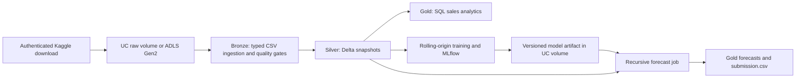

# Retail Sales Forecasting

Python, Spark SQL, Delta Lake, and MLflow pipeline for the [Kaggle Store Sales competition](https://www.kaggle.com/competitions/store-sales-time-series-forecasting/data). Forecast daily sales for each Ecuadorian store and product family over the provided 16-day test period.

The default Databricks bundle targets the supplied **AWS** workspace, `https://dbc-9b6ad1bb-15c7.cloud.databricks.com`, using serverless notebook jobs. The `azure` target and [Azure guide](docs/azure.md) provide Azure Databricks, ADLS Gen2, Unity Catalog managed identity, and Azure Data Factory integration. Azure resources are optional and have not been deployed by this project.

## Pipeline



- Ingestion enforces headers, types, uniqueness, finite/non-negative sales, complete test series, and store coverage. Invalid data stops the job before bronze writes.
- Training compares a global LightGBM model against recursive weekly seasonal forecasts using three expanding-window, 16-day backtests and RMSLE. It retains the baseline unless LightGBM improves mean validation RMSLE.
- Features include historical lags/rolling statistics, calendar/payday, promotion counts, store attributes, correctly located/transferred holidays, and prior oil observations. All target windows exclude the current day. During forecasting, oil is frozen at the forecast origin and subsequent lags use predictions. Transactions feed historical analytics, not forecast features.
- Training records Delta table versions, parameters, metrics, and model metadata. Scoring reads the same versions and emits exactly one non-negative prediction for every test ID.

## Local development

Use Python 3.12 and Java 17 (recommended for local Spark 3.5). In Codex cloud tasks, use the existing isolated checkout; a Git worktree is unnecessary.

```bash
cd /workspace/Retail-Sales-Forecasting
bash scripts/setup.sh
source /workspace/.venvs/retail-forecasting/bin/activate
bash scripts/test.sh
```

Elsewhere, set `RETAIL_VENV_DIR="$PWD/.venv"` and `RETAIL_DELTA_DIR="$PWD/.local-tools/delta"` before the setup/test scripts. `requirements.lock` pins the local environment; `requirements-runtime.txt` pins the Databricks model dependencies. Local Spark/Delta packages must **not** be installed over the Databricks runtime. The setup script downloads checksum-verified Maven artifacts for local Delta tests.

### Get the data

Accept the competition rules on Kaggle and download its data using your own authenticated account. Do not commit the data, API tokens, model artifacts, or personal credential files. If you use the official Kaggle CLI:

```bash
python -m pip install 'kaggle>=1.8,<2'
kaggle competitions download -c store-sales-time-series-forecasting -p data/raw
python -m zipfile -e data/raw/store-sales-time-series-forecasting.zip data/raw
```

Configure Kaggle authentication locally or in secure environment settings, not in source code or chat. `KAGGLE_API_TOKEN` is supported by current Kaggle CLI versions; alternatively use the CLI's documented credential configuration. The model requires these six files under one folder:

```text
train.csv  test.csv  stores.csv  oil.csv  holidays_events.csv  transactions.csv
```

```bash
retail-forecast train --data-dir data/raw --output-dir artifacts/run-01
retail-forecast predict --data-dir data/raw --model-dir artifacts/run-01/model \
  --output-dir artifacts/rescored
```

Training writes `model/model.joblib`, `model/metadata.json`, backtest predictions, forecasts, and a Kaggle-format `submission.csv`. Load joblib artifacts only from trusted training runs. The standard competition data is approximately three million training rows: local model training uses pandas on one machine, not distributed LightGBM. A 32 GB driver and four model threads are the documented cloud starting point; runtime and model accuracy on the full competition dataset remain to be measured.

## Run in Databricks

See [Databricks setup](docs/databricks.md) for prerequisites, notebook setup, CLI deployment, and required verification. The deployed job has no schedule. Deploying it does not start compute; explicitly running it may consume workspace capacity or incur cloud costs.

```bash
databricks auth login --host https://dbc-9b6ad1bb-15c7.cloud.databricks.com
databricks bundle validate -t dev
databricks bundle deploy -t dev
# Bootstrap the volumes and upload the six CSVs first; see the setup guide.
databricks bundle run -t dev retail_forecasting
```

The notebooks can also run from a Databricks Git folder. They install their pinned dependencies and import the package from the project source. Python restarts occur before any work; job parameters and Unity Catalog artifacts preserve task state. If your serverless environment has insufficient memory for full-panel training, choose an appropriately sized available environment or run the classic Azure target. Workspace permissions, serverless availability, and workload limits must be checked in your workspace.

## Validation status

Local tests exercise synthetic retail panels, real LightGBM training, multi-step scoring, model persistence, CSV contracts, Spark SQL analytics, and Delta Lake. [Validation details](docs/validation.md) distinguish these checks from cloud execution and Kaggle accuracy. The GitHub Actions workflow runs the same tests and builds a wheel. Synthetic fixture metrics are not a competition benchmark.

The rolling folds are used for model selection, so their mean RMSLE is not an unbiased final test estimate. A reserved holdout or the Kaggle evaluation is still required before making an accuracy claim. Known future promotions and holiday calendars are assumed available; this project does not forecast promotions or future oil prices. It scores the competition's supplied test panel, rather than arbitrarily generating future store/family horizons.

## Layout

| Path | Purpose |
|---|---|
| `src/retail_forecast/` | Data contracts, features, model, Spark transforms, local CLI |
| `notebooks/` | Bootstrap, ingestion, SQL analytics, training, scoring |
| `databricks.yml`, `resources/jobs.yml` | Databricks bundle and job configuration |
| `sql/analytics.sql` | Analyst queries and submission quality checks |
| `infra/azure/` | ADLS/managed identity infrastructure and ADF orchestration sample |
| `scripts/` | Repeatable setup, tests, bundle checks, ADLS upload |
| `tests/` | Leakage, quality, forecasting, and pipeline regression tests |
